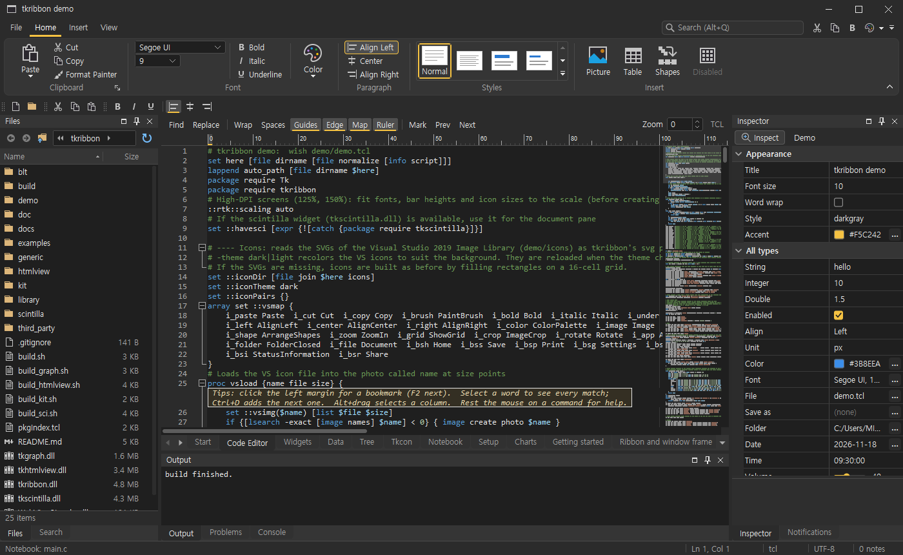
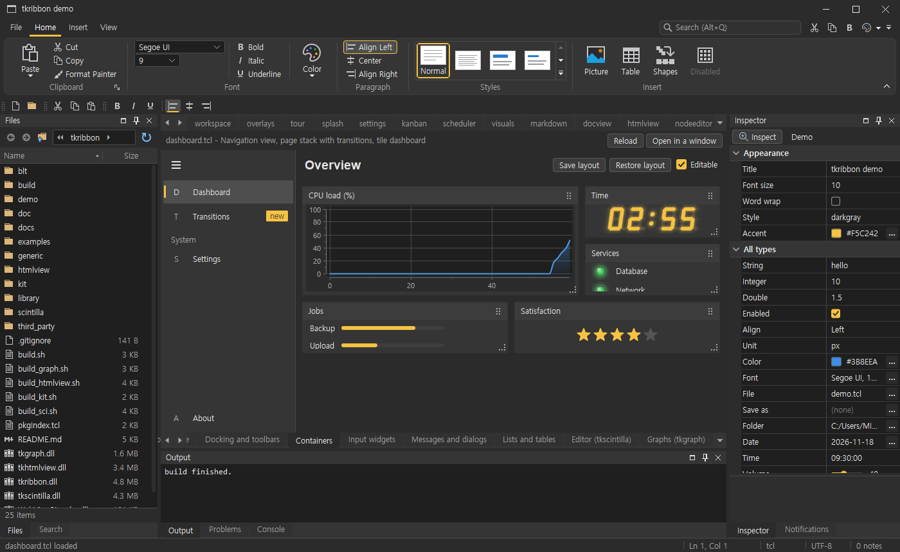
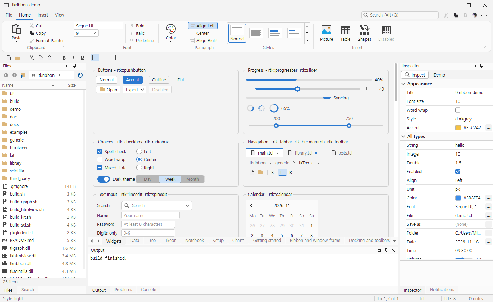
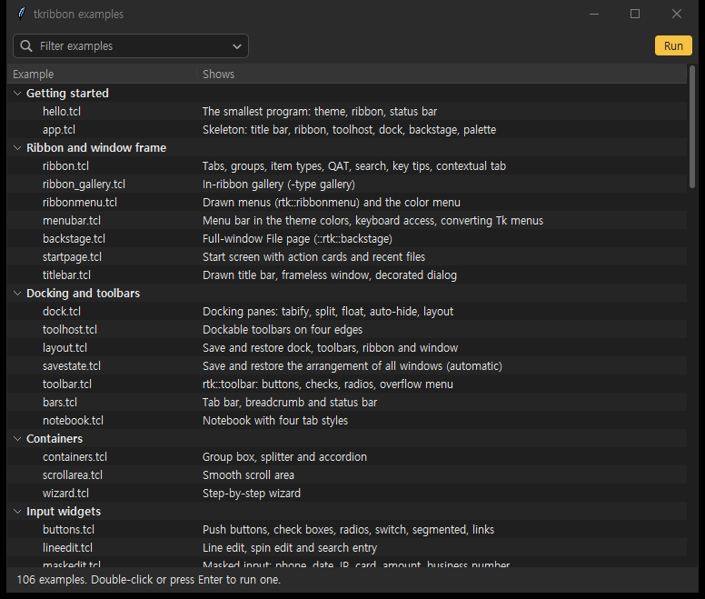

# tkribbon demo

Try **tkribbon**, an Office-style ribbon, docking panes and 60+ custom-drawn widgets for Tcl/Tk on Windows, written
in C. This repository holds the demo programs only; they need nothing installed.


## About this release

tkribbon is planned as a commercial product. Before deciding on licensing and pricing, I am releasing these demo
programs to see whether the library is useful to Tcl/Tk developers and what they would need from it. That is why the
programs are time-limited and the source is not public yet.

Your feedback helps decide what comes next: which widgets you would use, what is missing, which platforms or Tcl/Tk
versions matter to you, and what kind of license would work for you (per developer, per project, source included,
and so on). Please share it in the [Issues](https://github.com/hanulso78/tkribbon-demo/issues).

## Download

Get the executables from the [Releases](https://github.com/hanulso78/tkribbon-demo/releases) page:

| File | What it is |
|---|---|
| `tkribbon-demo.exe` | The demo: one window with a ribbon, docking panes, a code editor, widgets, a data grid, charts, and every example in tabs |
| `tkribbon-examples.exe` | The examples launcher: more than 100 small programs, one per widget or topic; double-click one to run it |

- Windows 10 or 11, 64-bit.
- The programs are not signed, so Windows SmartScreen may ask before starting them ("More info", then "Run anyway").
- The libraries in them are time-limited: they work for **15 days** from the first start on a PC.
- On the first start a program unpacks its files into `%LOCALAPPDATA%\tkribbon-demo` (or `tkribbon-examples`).
  To remove them, delete those folders.

## What is in tkribbon

| Package | What it adds |
|---|---|
| `tkribbon` | Ribbon (tabs, groups, galleries, quick access toolbar, key tips, contextual tabs, backstage), drawn title bar and frameless windows, docking panes (tabify, split, float, auto-hide), dockable toolbars, menu bar and drawn menus, themes with per-monitor DPI scaling, and widgets: buttons, line and masked edits, auto-completion, date and time edits, sliders, dials, ratings, color and font pickers, tree list, data grid, property grid, pivot table, spreadsheet, calendar scheduler, Gantt timeline, Kanban board, node editor, diagram editor, photo editor, hex editor, rich text editor, Markdown viewer, terminal, chat view, map view, QR codes and bar codes, web view (WebView2), task, input and progress dialogs, notification area (tray) icons, drag and drop, JSON and XML, saving and restoring the window arrangement |
| `tkscintilla` | Scintilla code editor with ruler, minimap, find bar, diff view, code outline and autocomplete |
| `tkgraph` | Graphs and charts: lines, bars, pie, heatmap, polar, 3D surfaces, figures with several plots, export |
| `tkhtmlview` | HTML/CSS viewer: flex, grid, CSS variables, gradients, history, find, zoom, forms |

All commands live in the `rtk::` namespace and load in Tcl/Tk 8.5 and 8.6 through stubs:

```tcl
package require tkribbon

::rtk::theme darkgray
rtk::ribbon .r
.r tab add home -text Home
.r group add home g -text Greeting
.r item add g hello -text "Say hello" -command {puts "Hello, world!"}
pack .r -fill x
```

## Screenshots

**Code editor** (tkscintilla) with the ruler, minimap and margin tips



**Dashboard example**: navigation view, tile dashboard, seven-segment clock, LEDs, ratings



**Graphs** (tkgraph): smooth lines with area fill, steps, zoom and crosshairs


**Widgets** in the light theme



**Examples launcher** (`tkribbon-examples.exe`)



## Feedback

Questions, comments and bug reports are welcome in the [Issues](https://github.com/hanulso78/tkribbon-demo/issues).
